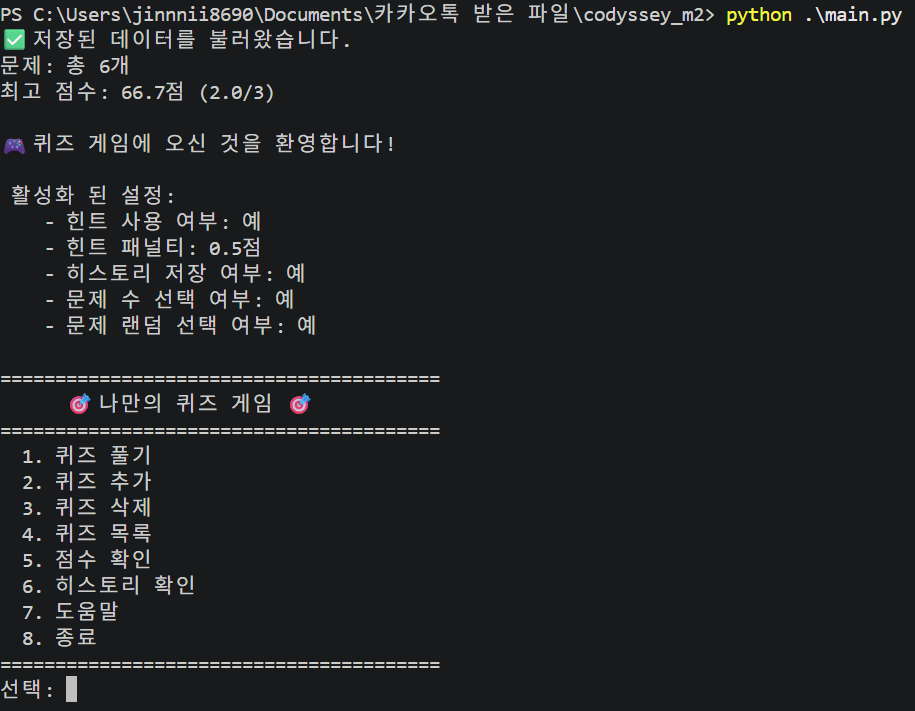
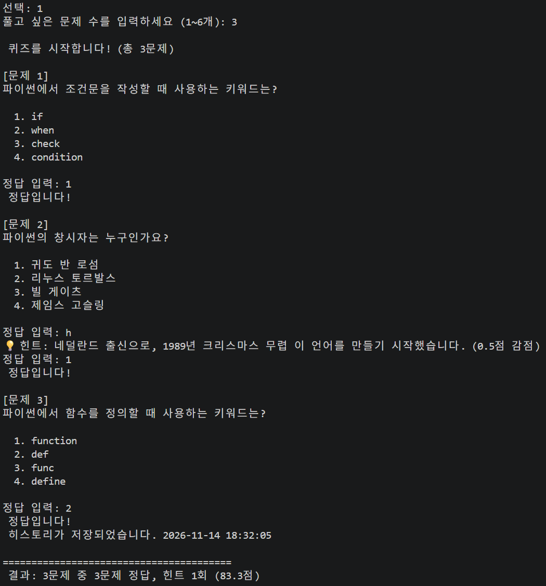
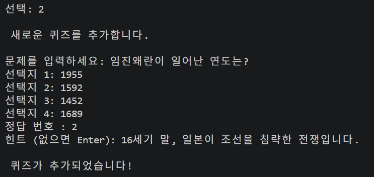
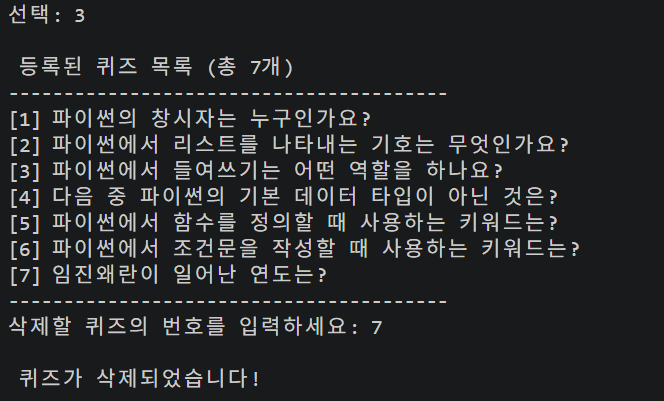
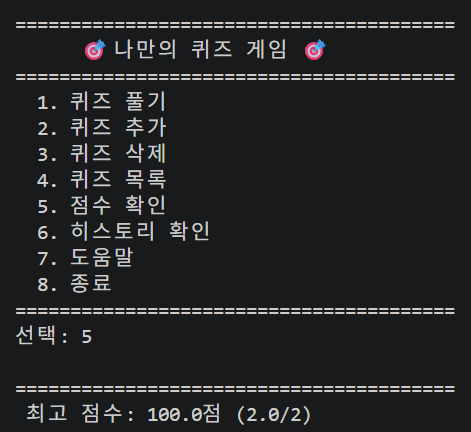
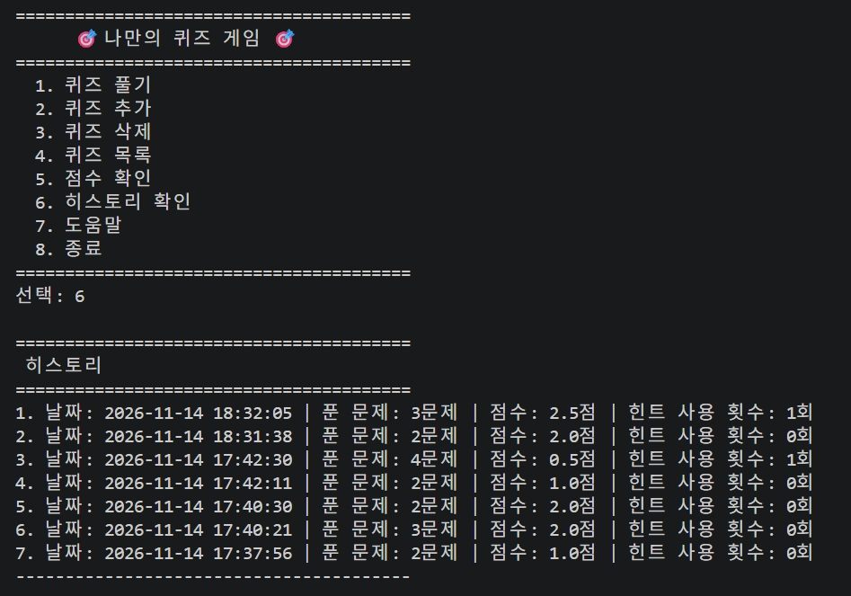
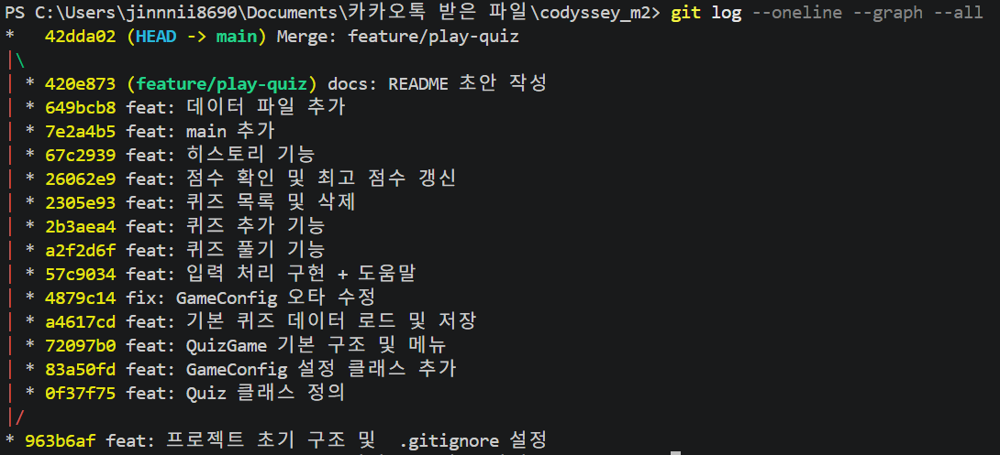
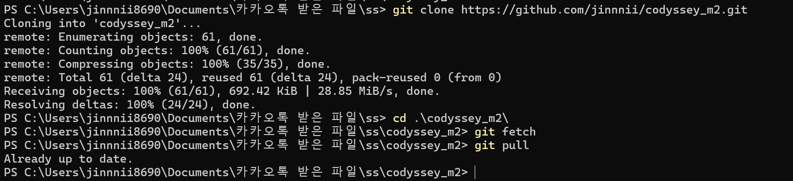

# Quiz Game

터미널에서 동작하는 퀴즈 게임.  
Python 표준 라이브러리만 사용하며, 클래스 기반으로 구조화하고 JSON으로 상태를 영속화한다.

## 프로젝트 개요

메뉴 기반 CLI 퀴즈 게임

- 퀴즈 풀기 / 추가 / 목록 / 삭제 / 점수 확인
- 프로그램을 종료해도 `state.json`에 데이터가 유지됨
- 힌트, 문제 수 선택, 랜덤 출제, 히스토리 저장 지원

## 퀴즈 주제 선정 이유

**주제: 파이썬 프로그래밍 기초**

이 미션 자체가 Python을 배우는 과정이므로,  
학습 내용과 직접 연관된 주제를 선택했다.  
문제를 풀면서 기초 개념을 복습할 수 있도록 구성했다.

## 요구 사항

- Python 3.10+
- 외부 라이브러리 없음

## 실행 방법

```bash
python main.py
```

## 실행 (`main.py`)
```python
from config import GameConfig
from quiz_game import QuizGame

config = GameConfig(
    shuffle=True, # (선택 과제) 문제 랜덤 출제
    qcount=True, # (선택 과제) 문제 개수 선택
    hint=True, # (선택 과제) 힌트 사용
    hint_penalty=0.5, # (선택 과제) 힌트 패널티
    save_history=True, # (선택 과제) 히스토리
)
game = QuizGame(config)
game.run()
```
- 설정 데이터 클래스를 만들어 실행

- 실행 화면


- 퀴즈 풀기


- 퀴즈 추가  


- 퀴즈 삭제  


- 점수 확인  


- 히스토리 



## 기능 목록
| 번호 | 기능 | 설명 |
| --- | --- | --- |
| 1 | 퀴즈 풀기 | 퀴즈 출제 및 채점 |
| 2 | 퀴즈 추가 | 문제, 선택지, 정답, 힌트 입력 |
| 3 | 퀴즈 삭제 | 등록된 퀴즈 삭제 |
| 4 | 퀴즈 목록 | 등록된 퀴즈 확인 |
| 5 | 점수 확인 | 최고 점수 확인 |
| 6 | 히스토리 | 게임 기록 확인 |
| 7 | 도움말 | 명령어 안내 |
| 8 | 종료 | 저장 후 종료 |


## 입력 명령어
- `q` : 현재 작업 취소 (메뉴로 이동)
- `h` : 힌트 보기 (문제 답변 입력 시)
- `exit` : 프로그램 종료
- `help` : 도움말

## 파일 구조
```
.
├── main.py            # 진입점
├── quiz.py            # Quiz 클래스
├── quiz_game.py       # QuizGame 클래스
├── config.py          # GameConfig
├── input_result.py    # InputResult 열거형
├── state.json         # 퀴즈 + 최고 점수
├── history.json       # 이력 (선택)
├── .gitignore
└── README.md
```


## 데이터 파일 
### `state.json`
```json
{
  "quizzes": [
    {
      "question": "문제 내용",
      "choices": ["선택지1", "선택지2", "선택지3", "선택지4"],
      "answer": 1,
      "hint": "힌트"
    }
  ],
  "best_score": 4.0,
  "best_total": 5
}
```
- 파일 없음 -> 기본 퀴즈 데이터로 생성
- 파일 손상 -> 안내 후 기본 퀴즈 데이터로 복구


### `history.json`
```json
[
  {
    "date": "2026-11-14 15:30:00", 
    "total_questions": 5,
    "score": 4.0,
    "hint_used": 1
  }
]
```
- 파일 없음 -> 게임 종료 후 자동 생성
- 새로운 기록은 최신 순으로 추가


## `GameConfig`: 설정
```python
@dataclass
class GameConfig:
    state_path: str = "state.json"
    history_path: str = "history.json"
    save_history: bool = True
    shuffle: bool = False
    hint: bool = False
    hint_penalty: float = 0.5
    qcount: bool = False
```

## `Quiz`: 개별 퀴즈 클래스
```python
class Quiz:
    def __init__(self, question: str, choices: list[str], answer: int, hint: str = None):
        self.question = question
        self.choices = choices
        self.answer = answer      # 1~4
        self.hint = hint

    def display(self, index: int) -> None:
        """문제와 선택지를 출력"""

    def check_answer(self, user_answer: int) -> bool:
        """정답 여부 확인"""

    def to_dict(self) -> dict:
        """JSON 저장용 딕셔너리로 변환"""

    @classmethod
    def from_dict(cls, data: dict) -> "Quiz":
        """딕셔너리에서 Quiz 객체 생성"""
```

## `QuizGame`: 게임 전체 흐름을 관리하는 클래스
```python
class QuizGame:
    def __init__(self, config: GameConfig):
        """설정 주입 후 데이터 로드"""

    def run(self) -> None:
        """메인 루프. 메뉴를 반복 표시하고 선택에 따라 분기"""

    def play_quiz(self) -> None:
        """퀴즈 진행 (출제, 채점, 결과)"""

    def add_quiz(self) -> None:
        """새 퀴즈 추가"""

    def delete_quiz(self) -> None:
        """퀴즈 삭제"""

    def list_quizzes(self) -> None:
        """등록된 퀴즈 목록 출력"""

    def show_score(self) -> None:
        """최고 점수 출력"""

    def show_history(self) -> None:
        """플레이 기록 출력"""

    def load_data(self) -> None:
        """state.json에서 퀴즈와 점수 불러오기"""

    def save_data(self) -> None:
        """state.json에 퀴즈와 점수 저장"""
```

### 호출 흐름
```
run()
├─ show_menu()                          # 메뉴 출력
│
├─ play_quiz()                          # 퀴즈 한 판 진행
│    ├─ _select_quizzes()               # (설정 시) 문제 수 선택 (qcount)
│    ├─ _shuffle_quizzes()              # (설정 시) 순서 섞기 (shuffle)
│    ├─ _run_quiz()                     # N개 퀴즈 실행 --> 정답 개수, 힌트 개수 카운팅 --> 점수 계산 --> 갱신 
│    │    └─ _ask_answer()              # 정답 입력 + 힌트 보기 처리 --> 입력한 정답, 힌트 사용 여부 리턴
│    │         └─ _get_answer_input()   # 힌트 허용 입력 --> 입력한 정답, 힌트 사용 여부 리턴
│    ├─ _calculate_score()              # 점수 계산 (힌트 감점)
│    ├─ _update_best_score()            # 최고 점수 갱신
│    ├─ _save_history()                 # (설정 시) 히스토리 저장
│    └─ _print_result()                 # 결과 출력
│
├─ add_quiz()                           # 퀴즈 추가
│    ├─ _get_str_input()                # 문제, 선택지 입력
│    └─ _get_int_input()                # 정답 번호 입력
│
├─ delete_quiz()                        # 퀴즈 삭제
│    └─ list_quizzes()                  # 퀴즈 목록 출력
│    └─ _get_int_input()                # 삭제할 번호 입력
│
├─ list_quizzes()                       # 퀴즈 목록 출력
├─ show_score()                         # 최고 점수 출력
├─ show_history()                       # 히스토리 출력
├─ print_abbreviations()                # 도움말 출력
│
├─ 입력 처리
│    ├─ _get_int_input()                # 숫자만 필요할 때 --> 값(숫자)만 리턴
│    │    └─ _read_int()                # 범위 체크, 숫자 변환 --> (VALUE, 값) 으로 리턴 (힌트 제외)
│    │         └─ _get_input_result()   # 특수 입력 처리 (q, h, exit 등) --> VALUE 리턴
│    │
│    ├─ _get_answer_input()             # 정답 입력 (힌트 허용), --> (HINT 또는 VALUE, 값)으로 리턴
│    │    └─ _read_int(hint_yn=True)    # 범위 체크, 숫자 변환 --> (HINT 또는 VALUE, 값)으로 리턴
│    │         └─ _get_input_result()   # 특수 입력 처리 (q, h, exit 등) --> HINT 또는 VALUE 리턴
│    │
│    ├─ _get_str_input()                # 문자열 입력: 필수 여부, 범위 체크 --> 값(문자열) 리턴
│    │    └─ _get_input_result()        # 특수 입력 처리 (q, h, exit 등) -->  VALUE 리턴
│    │
│    └─ _get_bool_input()               # y/n 입력 : 'y' 또는 'n' 체크 -> True/False 리턴
│         └─ _get_str_input()           # 문자열 입력: 필수 여부, 범위 체크 --> 값(문자열) 리턴
│              └─ _get_input_result()   # 특수 입력 처리 (q, h, exit 등) -->  VALUE 리턴
│
├─ load_data() / save_data()            # state.json 읽기/쓰기
└─ load_history() / _save_history()     # history.json 읽기/쓰기
```


### 예외 처리 흐름 
```
사용자 입력
│
├─ 빈 입력 ──────────────→ (필수 입력인 경우) 안내 후 다시 입력
├─ 숫자 아님 ────────────→ (숫자 입력인 경우) 안내 후 다시 입력
├─ 범위 밖 ──────────────→ (숫자 입력인 경우) 안내 후 다시 입력
│
├─ "h"
│    ├─ 퀴즈 정답 입력 중 ─→ 힌트 출력 (감점은 1회만)
│    │                         └─ 같은 문제에서 다시 입력
│    │
│    ├─ 숫자 입력 중 ──────→ "숫자만 입력해주세요" 후 다시 입력
│    │
│    └─ 문자열 입력 중 ────→ 그냥 문자열 "h"로 처리
│
├─ "q" ──────────────────→ UserExit 발생
│                              │
│                              ├─ 퀴즈 중이면 → 이력 저장 여부 확인 → 메뉴로
│                              └─ 그 외 → 메뉴로
│
├─ "exit" ───────────────→ save_data() → 프로그램 종료
├─ Ctrl+C / EOF 예외 ─────→ save_data() → 프로그램 종료
│
└─ 정상 입력 ────────────→ 해당 기능 실행파일 관련
│
├─ state.json 없음 ──────→ 기본 퀴즈 로드 → save_data()
├─ state.json 손상 ──────→ 안내 → 기본 퀴즈로 복구 → save_data()
└─ state.json 저장 실패 ──→ 오류 메시지 출력 (게임은 계속)
│
├─ history.json 없음 ────→ 빈 목록으로 시작
└─ history.json 저장 실패 → 오류 메시지 출력 (게임은 계속)
```

## `InputResult`: 특수 입력을 구분하는 열거형 
```python
class InputResult(Enum):
    VALUE = auto()   # 일반 입력
    EMPTY = ""       # 빈 입력
    HINT = "h"       # 힌트
    QUIT = "q"       # 메뉴로 나가기
    EXIT = "exit"    # 프로그램 종료
    HELP = "help"    # 도움말
```

## 종료 처리
프로그램 종료 시 데이터 손실을 방지하기 위해 아래와 같이 처리한다.

| 상황 | 처리 |
|------|------|
| 메뉴에서 종료 선택 | `save_data()` 호출 후 종료 |
| `exit` 입력 | `save_data()` 호출 후 종료 |
| `Ctrl+C` (`KeyboardInterrupt`) | `save_data()` 호출 후 종료 |
| `EOFError` | `save_data()` 호출 후 종료 |

현재는 `KeyboardInterrupt`와 `EOFError`로 종료를 처리한다.  
`SIGINT`(Ctrl+C)는 `KeyboardInterrupt`로 잡히므로 별도 `signal` 핸들러 없이도 저장 후 종료된다.
`SIGTERM` 등 다른 시그널까지 처리하려면 아래처럼 확장할 수 있다.

```python
import signal

def handle_signal(signum, frame):
    print("\n종료 시그널을 받았습니다. 저장 후 종료합니다.")
    game.save_data()
    sys.exit(0)

signal.signal(signal.SIGINT, handle_signal)
signal.signal(signal.SIGTERM, handle_signal)
```

## 부가 설명
### 1. `InputResult` 를 만든 이유
**목적**  
- 선택 과제인 힌트 기능이 추가되면서 `h`(힌트), `q`(나가기) 같은 특수 입력을 처리해야 했다.  
- 문자열을 직접 비교하는 대신, 입력의 종류를 명확히 구분하기 위해 `InputResult`를 도입했다.

**변경 내용**  
- 이전: `if user_input == "q"`처럼 문자열을 직접 비교
- 이후: `if result == InputResult.HINT` 등으로 비교

**효과**  
- `"q"`, `"h"` 같은 문자열이 코드에 흩어지지 않음
- 입력 결과가 `(InputResult, 값)` 형태로 일관되게 반환됨
- 오타나 대소문자 차이로 인한 실수를 줄일 수 있다.
- 특수 명령을 추가하거나 변경할 때 Enum만 수정하면 된다.
- 함수 반환값의 의미가 분명해진다.

### 2. 입력 처리 흐름

**목적**  
메뉴 선택, 퀴즈 정답, 문제 추가 등 여러 곳에서 입력을 받아야 해서  입력 검증과 특수 명령 처리를 공통 메서드로 분리했다.

**효과**  
- 빈 입력, 범위 초과, `q`/`h` 처리가 한곳에서 이루어짐
- 입력 관련 버그를 수정할 때 해당 메서드만 보면 됨
- 퀴즈 정답 입력처럼 힌트가 필요한 경우와 그렇지 않은 경우를 나눌 수 있음

| 메서드 | 하는 일 |
|--------|---------|
| `_get_input_result` | 입력을 해석해서 `q`, `h`, `exit` 등을 구분 |
| `_read_int` | 범위 안의 숫자를 입력받을 때까지 반복 |
| `_get_int_input` | 숫자만 필요할 때 사용 (메뉴, 문제 수 등) |
| `_get_answer_input` | 퀴즈 정답 입력 (힌트 허용) |
| `_get_str_input` | 문자열 입력 (문제, 선택지 등) |
| `_get_bool_input` | y/n 입력 |


**호출 예시**
- 메뉴 번호를 고를 때

    `_get_int_input("선택: ", 1, 8) `→ `_read_int("선택: ", 1, 8)`  
    &nbsp;&nbsp;&nbsp;&nbsp;1. 입력 받기 (`input()`)    
    &nbsp;&nbsp;&nbsp;&nbsp;2. `_get_input_result` : `q`, `exit` 등 특수 입력 & 빈 문자열인지 확인  
    &nbsp;&nbsp;&nbsp;&nbsp;3. 숫자로 변환 (`int(str)`)    
    &nbsp;&nbsp;&nbsp;&nbsp;4. 1~8 범위인지 확인

- 퀴즈 정답을 입력할 때  
    `_get_answer_input("정답 입력: ")` → `_read_int("정답 입력: ", 1, 4, hint_yn=True)`    
    &nbsp;&nbsp;&nbsp;&nbsp;1. 입력 받기 (`input()`)  
    &nbsp;&nbsp;&nbsp;&nbsp;2. `_get_input_result` : `q`, `exit` 등 특수 입력 & 빈 문자열인지 확인 + `h`면 힌트 요청으로 반환  
    &nbsp;&nbsp;&nbsp;&nbsp;3. 숫자로 변환 (`int(str)`)  
    &nbsp;&nbsp;&nbsp;&nbsp;4. 1~4 범위인지 확인

- 문제를 추가할 때  
    `_get_str_input("문제를 입력하세요: ", allow_empty=False)`  
    &nbsp;&nbsp;&nbsp;&nbsp;1. 입력 받기 (`input()`)  
    &nbsp;&nbsp;&nbsp;&nbsp;2. 필수 입력(`allow_empty=False`)인지 확인 후 반환   
    &nbsp;&nbsp;&nbsp;&nbsp;2. `_get_input_result` : `q`, `exit` 등 특수 입력인지 확인 & 빈 문자열인지 확인  
    &nbsp;&nbsp;&nbsp;&nbsp;3. 길이 제한 확인 후 반환  


- 저장 여부를 확인할 때
    `_get_bool_input("저장하시겠습니까? (y/n): ")`  
    → `_get_str_input`으로 문자열을 받은 뒤  
    &nbsp;&nbsp;&nbsp;&nbsp;1. `_get_str_input` 내부에서 `_get_input_result`로 특수 입력 확인  
    &nbsp;&nbsp;&nbsp;&nbsp;2. `"y"`면 True, `"n"`이면 False 반환  
    &nbsp;&nbsp;&nbsp;&nbsp;3. 그 외에는 다시 물어봄

### 3. `UserExit`: 예외 처리 
```python
class UserExit(Exception):
    """
    사용자가 퀴즈 진행 중 나가기(q)를 선택했을 때 발생하는 예외 처리
    단순히 메뉴로 돌아가는 것 외에도,
    지금까지 푼 문제 수, 정답 수, 힌트 사용 횟수를 함께 전달해서 중간 저장 여부를 판단할 수 있게 한다.
    """

    def __init__(self, total: int = 0, correct: int = 0, hint_used: int = 0, curr_idx: int = 0):
        self.total = total  # 문제 총 개수
        self.correct = correct  # 정답 개수
        self.curr_idx = curr_idx # 현재 문제 위치
        self.hint_used = hint_used # 힌트 사용 횟수
        super().__init__()

```
**목적**  
퀴즈를 풀다가 `q`를 눌렀을 때, 그냥 종료하지 않고 메뉴로 돌아가면서  
지금까지의 진행 상황도 함께 전달하기 위해 만들었다.

**처리 내용**  
- `q` 입력 시 `UserExit` 발생
- 푼 문제 수, 정답 수, 힌트 사용 횟수를 예외에 담음
- `play_quiz`에서 예외를 잡아서 중간 저장 여부를 물어봄
- `y` 입력 시 지금까지의 결과를 히스토리에 저장

**효과**  
- 중간에 나가도 진행 상황을 잃지 않는다.
- 저장 여부를 사용자가 선택할 수 있다.
- 메뉴로 자연스럽게 돌아갈 수 있다.

**동작 원리**
- q를 입력하면 raise UserExit(total, correct, hint_used, i)로 예외를 발생시킨다.
- 예외 객체 안에 지금까지의 진행 상황을 담는다.
- play_quiz의 except UserExit as e:에서 이 예외를 잡는다.
- e.correct, e.hint_used 등으로 진행 상황을 꺼내서 사용한다.
- 저장 여부를 물어본 뒤, 메뉴로 돌아간다.

## Git
- 기능 단위로 커밋하고 브랜치를 사용했다.

```bash
git switch -b feature/play-quiz
# 커밋 진행 후
git checkout main
git merge feature/play-quiz
git push
```
**로그**
- 10개 이상의 커밋, 병합 증적

| 순서 | 커밋 | 메시지 | 원래 브랜치 |
| --- | --- | --- | --- |
| 1 | 963b6af | feat: 프로젝트 초기 구조 및 .gitignore 설정 | main |
| 2 | 0f37f75 | feat: Quiz 클래스 정의 | feature/play-quiz |
| 3 | 83a50fd | feat: GameConfig 설정 클래스 추가 | feature/play-quiz |
| 4 | 72097b0 | feat: QuizGame 기본 구조 및 메뉴 | feature/play-quiz |
| 5 | a4617cd | feat: 기본 퀴즈 데이터 로드 및 저장 | feature/play-quiz |
| 6 | 4879c14 | fix: GameConfig 오타 수정 | feature/play-quiz |
| 7 | 57c9034 | feat: 입력 처리 구현 + 도움말 | feature/play-quiz |
| 8 | a2f2d6f | feat: 퀴즈 풀기 기능 | feature/play-quiz |
| 9 | 2b3aea4 | feat: 퀴즈 추가 기능 | feature/play-quiz |
| 10 | 2305e93 | feat: 퀴즈 목록 및 삭제 | feature/play-quiz |
| 11 | 26062e9 | feat: 점수 확인 및 최고 점수 갱신 | feature/play-quiz |
| 12 | 67c2939 | feat: 히스토리 기능 | feature/play-quiz |
| 13 | 7e2a4b5 | feat: main 추가 | feature/play-quiz |
| 14 | 649bcb8 | feat: 데이터 파일 추가 | feature/play-quiz |
| 15 | 420e873 | docs: README 초안 작성 | feature/play-quiz |
| 16 | 42dda02 | Merge: feature/play-quiz | main (병합) |


```bash
git log --oneline --graph --all
```
- Git 로그 출력 캡처


## 과제 목표

이 미션을 마친 후 아래 내용을 스스로 설명할 수 있어야 한다.

### Python 기초

**변수**  
값을 저장하는 이름 있는 공간. 정확히는 객체를 가리키는 이름이다.  
불변 객체(`int`, `str`)는 값을 바꾸면 새 객체가 생기고,  
가변 객체(`list`, `dict`)는 같은 객체를 여러 변수가 참조할 수 있다.
```
불변:
[a] ──→ 10
[b] ──→ 20

가변:
[x] ──┐
      ├──→ [1, 2, 3, 4]
[y] ──┘
```

**자료형**

| 자료형 | 설명 |
|--------|------|
| `int` | 정수 |
| `str` | 문자열 |
| `bool` | 참/거짓 |
| `list` | 순서가 있는 여러 값 |
| `dict` | 키-값 쌍 |

**조건문**  
`if` / `elif` / `else`로 조건에 따라 다른 코드를 실행한다.

**반복문**  
- `for`: 횟수나 대상이 정해져 있을 때  
- `while`: 조건이 참인 동안 반복할 때

**함수**  
특정 작업을 묶어 이름을 붙인 것. 매개변수(`args`) 로 값을 받고, `return`으로 결과를 돌려준다.

### 클래스와 객체

**클래스**  
`속성`과 `메서드`를 하나로 묶은 사용자 정의 타입.  
같은 구조의 객체를 여러 개 만들 수 있다.

**`__init__`과 `self`**  
- `__init__`: 객체가 생성될 때 실행되는 초기화 메서드  
- `self`: 객체 자기 자신을 가리킴

**속성과 메서드**  
- 속성: 객체가 가지는 데이터  
- 메서드: 객체가 수행하는 동작

### 파일 입출력

**파일 열기/읽기/쓰기**

```python
# 쓰기
with open("파일명", "w", encoding="utf-8") as f:
    f.write("내용")

# 읽기
with open("파일명", "r", encoding="utf-8") as f:
    data = f.read()
```

### Git 기초
**주요 명령어**

| 명령어 | 설명 |
|--------|------|
| `git init` | 현재 폴더를 Git 저장소로 초기화 |
| `git add` | 변경된 파일을 스테이징(커밋 대기 상태)에 올림 |
| `git commit` | 스테이징된 변경 사항을 기록 |
| `git push` | 로컬 커밋을 원격 저장소(GitHub)에 업로드 |
| `git pull` | 원격 저장소의 변경 사항을 가져와 병합 |
| `git checkout` | 브랜치 전환 또는 새 브랜치 생성 (`-b`) |
| `git clone` | 원격 저장소를 통째로 로컬에 복제 |

**clone / pull / fetch**
| 명령어 | 설명 |
| --- | --- |
| `clone` | 원격 저장소를 처음 내 컴퓨터로 통째로 복제 |
| `fetch` | 원격 변경 사항을 가져오기만 하고, 현재 브랜치에는 반영하지 않음 |
| `pull` | 원격 변경 사항을 가져와서 현재 브랜치에 병합 (fetch + merge) |

- clone, pull, petch 증적
```bash
git clone https://github.com/jinnnii/codyssey_m2.git
git fetch
git pull
```


**checkout vs switch**
| 명령어 | 설명 |
|--------|------|
| `checkout` | 예전부터 쓰던 명령. 브랜치 전환 + 파일 복원 등 여러 용도 |
| `switch` | 브랜치 전환만 담당|
- 요즘은 `switch`를 쓰는 경우가 늘고 있지만, 기존 자료나 습관 때문에 `checkout`도 여전히 많이 사용된다.

**커밋 메시지 규칙**

```
타입: 설명

예시:
feat: 퀴즈 풀기 기능 구현
fix: GameConfig 오타 수정
docs: README 초안 작성
refactor: 입력 처리 메서드 분리
```

| 타입 | 의미 |
| --- | --- |
| feat | 새로운 기능 |
| fix | 버그 수정 |
| docs | 문서 수정 |
| refactor | 리팩토링 |
| chore | 설정, 빌드 등 |

## 대량 데이터 고려사항
현재 구조는 퀴즈를 메모리에 모두 올린 뒤 처리한다.
퀴즈가 1000개 이상일 경우 아래 문제가 발생할 수 있다.

| 항목 | 예상 문제 | 개선 방안 |
| --- | --- | --- |
| 메모리 | 모든 퀴즈를 list에 보관 | 필요한 만큼만 로드 (페이징) |
| 검색 | 목록 출력 시 전체를 순회 | 인덱스 또는 DB 사용 고려 |
| 저장 | 매번 전체 JSON을 다시 씀 | 변경된 부분만 저장하거나 스트리밍 방식 |
| 출제 | random.sample로 전체에서 추출 | 개수가 많아도 동작은 하나, 메모리 점유는 동일 |

현재 학습용 프로젝트에서는 퀴즈 수가 적으므로,
메모리에 모두 로드하는 방식으로 충분하다.

## 데이터 백업 및 복구
### 백업 정책
- `save_data()` 호출 시 `state.json.bak`으로 이전 파일을 백업한다.

### 복구 절차

**1. 자동 복구**  
`state.json`이 손상되면 프로그램이 기본 퀴즈로 복구한다.

**2. 수동 복구**  
백업 파일이 있을 경우:

```bash
# 최신 백업으로 복구
cp state.json.bak state.json
```

**3. 복구 스크립트 예시**
```python
import shutil
import os

def restore_backup():
    if os.path.exists("state.json.bak"):
        shutil.copy("state.json.bak", "state.json")
        print("백업에서 복구했습니다.")
    else:
        print("백업 파일이 없습니다.")
```

## 요구사항 변경 시 수정 위치

| 변경 내용 | 수정할 곳 |
|-----------|-----------|
| 점수 계산 방식 변경 | `_calculate_score` 에서 계산식 변경 |
| 힌트 사용 여부 | `GameConfig.hint` |
| 힌트 패널티 값 변경 | `GameConfig.hint_penalty` |
| 문제 수 선택 여부 | `GameConfig.qcount`, `play_quiz` |
| 랜덤 출제 여부 | `GameConfig.shuffle`, `play_quiz` |
| 히스토리 저장 여부 | `GameConfig.save_history` |
| 저장 파일 경로 변경 | `GameConfig.state_path`, `GameConfig.history_path` |
| 저장 형식 변경 | `save_data`, `load_data` |
| 메뉴 항목 추가 | `show_menu`, `run` |
| 입력 명령 추가 | `InputResult`, `_get_input_result` |
| 히스토리 항목 추가 | `_save_history`, `show_history` |
| 기본 퀴즈 변경 | `_load_default_quizzes` |